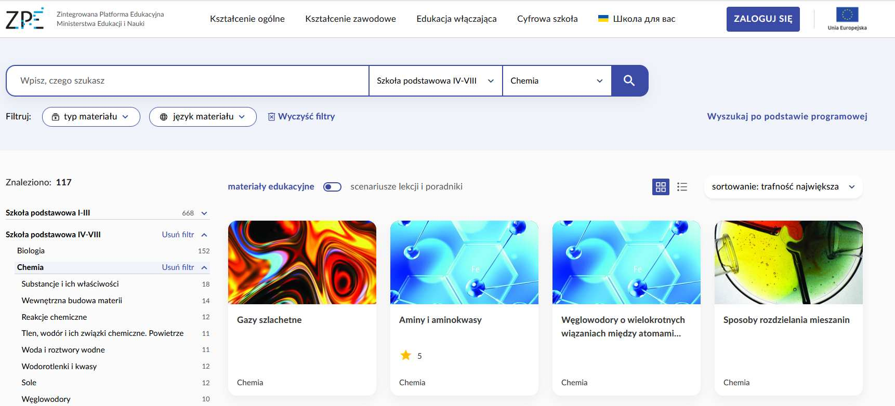
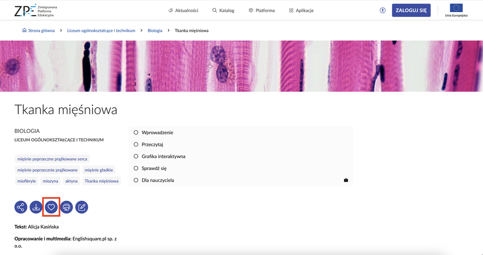
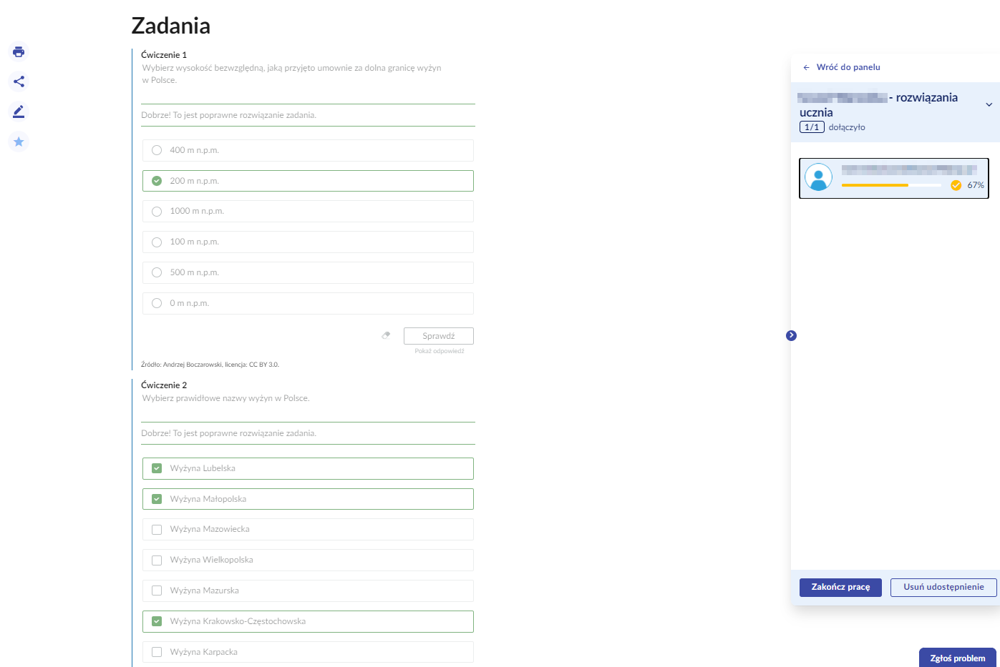
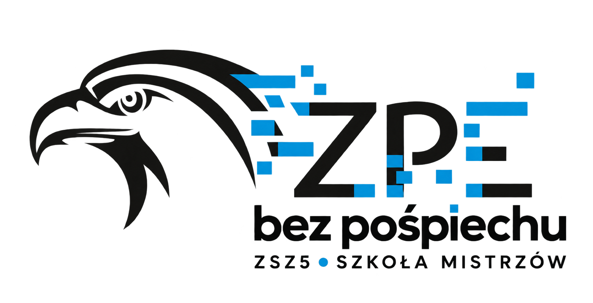

# ZPE bez pośpiechu — szkolenie dla nauczycieli

**Gotowe materiały, praca z klasą i wygodne sprawdzanie odpowiedzi.**

Autor opracowania: Maciej Najwer. Projekt WIN4SMEs · COVE Polska · ZSZ5 — Szkoła Mistrzów.

Przewodnik: [ZPE bez pośpiechu](https://metodyka.covepolska.pl/szkolenie%20ZPE/).

## 1. Czym jest ZPE i do czego się przydaje?

Zintegrowana Platforma Edukacyjna (ZPE) to publiczna, bezpłatna platforma Ministerstwa Edukacji Narodowej, dostępna pod adresem [zpe.gov.pl](https://zpe.gov.pl/). Zawiera materiały do kształcenia ogólnego i zawodowego: teksty, filmy, ilustracje, multimedia i ćwiczenia.

Na początku nie trzeba tworzyć własnych materiałów. Można wybrać gotową lekcję, udostępnić ją klasie w kursie, a następnie sprawdzić zapisane odpowiedzi uczniów na swoim komputerze. Materiały nadają się do pracy na lekcji oraz do pracy w domu — trzeba dobrać je do celu i poziomu klasy.

## 2. Plan szkolenia

1. Logowanie na konto szkolne i sprawdzenie właściwej szkoły lub przestrzeni.
2. Wyszukiwanie gotowych materiałów.
3. Zapisywanie w Ulubionych i powrót do wybranych zasobów.
4. Teczka — zbieranie fragmentów, gdy potrzebujemy własnego zestawu.
5. Uczniowie i grupy oraz odzyskiwanie dostępu.
6. Kurs dla klasy: pierwsza lekcja, publikacja i zapis uczniów.
7. Dodawanie kolejnych lekcji i kontrolowanie momentu ich udostępnienia.
8. Sprawdzanie odpowiedzi, informacja zwrotna, ocena i dokończenie pracy w domu.
9. Kurs a podręcznik modułowy.
10. Link do rozszerzenia o Kreatorze dla zainteresowanych.

Podstawowa ścieżka szkolenia opiera się na gotowych materiałach ZPE. Teczka i Kreator są możliwościami dalszej pracy.

## 3. Konto szkolne — dane od dyrektora i powiązanie z SIO

Do logowania na konto szkolne używamy loginu i hasła przekazanego przez dyrektora szkoły lub osobę odpowiedzialną za dostęp. Są to dane konta powiązanego z Systemem Informacji Oświatowej (SIO).

1. Otwórz [zpe.gov.pl](https://zpe.gov.pl/) i wybierz „Zaloguj się”.
2. Wpisz otrzymany login i hasło. Wielkość liter w haśle ma znaczenie.
3. Sprawdź, czy pracujesz w odpowiedniej szkole lub przestrzeni.
4. Sprawdź dostępne klasy, grupy i listę uczniów.

Na prawidłowo przypisanym koncie szkolnym dane uczniów i klas wynikają z integracji z SIO. Możesz korzystać z klas, w których uczysz, zapisywać je do kursów i — w zakresie swoich uprawnień — zarządzać przypisanymi uczniami. Nie trzeba zakładać wszystkim uczniom kolejnych kont.

Konto utworzone samodzielnie nie jest automatycznie tym samym kontem co konto szkolne z SIO. Jeśli nie widzisz właściwej klasy, najpierw sprawdź konto, wybraną szkołę i przypisanie w szkole. Nie zakładaj od razu nowego konta ani zastępczej klasy.

## 4. Jak wyszukiwać materiały?

1. Wpisz pojęcie, temat lub nazwę czynności, np. „obliczenia procentowe”.
2. Wybierz etap edukacyjny i przedmiot.
3. Otwórz wyniki i sprawdź dokładną treść, nie tylko tytuł.
4. W kształceniu zawodowym spróbuj nazwy czynności, zawodu lub symbolu kwalifikacji.
5. Jeśli wyników jest za dużo, doprecyzuj hasło lub filtr. Jeśli ich brakuje, skróć zapytanie, usuń filtr albo użyj innego określenia.

Wybieraj konkretny fragment przydatny na lekcji. Nie musisz zadawać całego zasobu. Sprawdź poziom języka, poprawność, aktualność i działanie ćwiczeń na urządzeniach uczniów.

*Ekran z poradnika praktycznego, s. 7. To przykład z dokumentu, nie aktualny zrzut konta uczestnika.*

## 5. Jak zachować materiał i nie szukać od nowa? Ulubione i Teczka

### Ulubione — mój bank gotowych lekcji

Na zalogowanym koncie otwórz materiał i kliknij serce „Dodaj do ulubionych”. Wrócisz do niego przez **Katalog → Ulubione**. Ponowne kliknięcie serca usuwa zapis.

Możesz w ten sposób zbierać materiały na cały semestr. Sam zapis w Twoich Ulubionych nie przypisuje ich uczniom.

*Ilustracja z publicznej instrukcji „Ulubione” ZPE.*

### Teczka — gdy potrzebuję fragmentów zamiast całych lekcji

1. Otwórz panel Teczki i włącz jego przełącznik.
2. Przy wybranym fragmencie materiału użyj plusa.
3. Zbieraj elementy także z różnych zasobów.
4. Wybierz „Utwórz materiał z elementów”. Poradnik wskazuje zapis w **Katalog → Moje**.
5. Utworzony zestaw możesz dalej edytować i dodać do kursu.

Teczka tworzy własny zestaw z fragmentów. Jeśli chcesz pracować wyłącznie z całymi gotowymi lekcjami, wystarczą **Ulubione i kurs**.

## 6. Użytkownicy, grupy i odzyskiwanie dostępu

Jeżeli właściwa klasa jest już dostępna na koncie szkolnym, skorzystaj z niej. Osobną grupę twórz wtedy, gdy potrzebujesz innego zestawu osób, np. na koło zainteresowań.

W poradniku kursów lista uczniów znajduje się w **Platforma → Uczniowie**. Zaznaczenie osób pozwala skorzystać z dostępnych opcji grup, a grupę można następnie zapisać do kursu.

Gdy uczeń nie może się zalogować:

1. Sprawdź, czy korzysta z właściwego konta.
2. Odszukaj go przez **Platforma → Uczniowie**.
3. Otwórz menu trzech kropek przy uczniu.
4. Jeżeli masz uprawnienia, użyj dostępnej zmiany hasła lub adresu e-mail.
5. Zastosuj wymagania bieżącego formularza, a nowe hasło przekaż uczniowi indywidualnie.

Brak uprawnień lub brak właściwego ucznia na liście wymaga sprawdzenia przypisania w szkole albo kontaktu ze wsparciem ZPE. Nie należy zakładać, że nauczyciel może zmieniać dane każdego konta.

## 7. Od gotowej lekcji do sprawdzenia pracy uczniów

**Ulubione → klasa lub grupa → kurs → publikacja i zapis uczniów → praca uczniów → analiza → ocena i informacja zwrotna.**

### Krok 1. Zbieram lekcje

Wybieram gotowe zasoby ZPE i zapisuję je w Ulubionych. Materiały na później mogą tam czekać.

### Krok 2. Wybieram klasę lub grupę

Sprawdzam odbiorców, np. klasę 1PF. Jeśli klasa jest już dostępna, nie tworzę jej drugi raz.

### Krok 3. Tworzę kurs

Otwieram pierwszą lekcję i wybieram **Udostępnij → Platforma edukacyjna**, jeśli pojawia się ten wybór. Wybieram właściwą szkołę lub przestrzeń oraz nowy kurs, np. **„Informatyka — 1PF — 2026/2027”**.

Osobne kursy ułatwiają pracę z klasami w różnym tempie. Jeden kurs można również udostępnić kilku grupom — wtedy opublikowane zmiany są wspólne dla jego uczestników.

### Krok 4. Publikuję i zapisuję uczniów

Klikam **Opublikuj**, a następnie w kursie **Uczniowie → Zapisz uczniów**. Wybieram osoby lub grupę, przechodzę dalej i zatwierdzam zapis.

**Nie publikuję tego dla całego internetu.** Tytuł i samo utworzenie kursu nie udostępniają go wszystkim użytkownikom ZPE. Publikacja przygotowuje wersję dla zapisanych uczestników. Kurs w przestrzeni szkolnej może też podlegać uprawnieniom jej administratorów.

### Krok 5. Uczniowie pracują

Uczniowie logują się i otwierają przypisany kurs. Podaję dokładne polecenie, np. „Otwórz dzisiejszą lekcję i wykonaj zadania 1–4 w części Sprawdź się”.

Przed pierwszą pracą na ocenę sprawdzam na koncie testowym, czy konkretne ćwiczenia zapisują odpowiedzi. Samo wysłanie publicznego linku do lekcji nie zastępuje przypisania jej w kursie.

### Krok 6. Stopniowo dodaję kolejne lekcje

Wracam do Ulubionych i dodaję kolejny materiał do istniejącego kursu albo wybieram w kursie „Dodaj element”.

| Przycisk | Znaczenie |
| --- | --- |
| **Zapisz** | Zachowuje wersję roboczą. Uczniowie nadal widzą poprzednią opublikowaną wersję. |
| **Opublikuj** | Udostępnia najnowszą wersję całego kursu, z uwzględnieniem ograniczeń etapów. |

„Opublikuj” nie jest przełącznikiem pojedynczej lekcji. Jeżeli dodam kilka lekcji bez ograniczeń, publikacja udostępni je wszystkie. Najprostszy model: materiały na później trzymam w Ulubionych, do kursu dodaję kolejną lekcję i publikuję ją wtedy, gdy klasa ma z nią pracować. Planowanie dostępu z góry wymaga ustawień etapów.

### Krok 7. Wygodnie sprawdzam odpowiedzi na swoim komputerze

Otwieram **kurs → Analiza → Pokaż szczegółowy raport**. Rozwijam grupę i przeglądam wyniki. Otwieram konkretny materiał i wybieram ucznia w panelu po prawej, aby obejrzeć jego odpowiedzi.

Mogę sprawdzić, co zaznaczył lub wpisał, które zadania rozwiązał i gdzie popełnił błąd — o ile te ćwiczenia obsługują zapis wyników. Nie muszę oglądać odpowiedzi osobno na każdym uczniowskim komputerze.

*Ilustracja ze starszego interfejsu, PDF „Udostępnianie i wyniki”, s. 18. Pokazuje zaznaczone rozwiązania, nie obecną ścieżkę wejścia do raportu. W modelu kursów korzystamy z „Analizy”.*

### Krok 8. Oceniam, omawiam albo zlecam dokończenie w domu

Zapisane odpowiedzi mogą być podstawą oceny według kryteriów przedstawionych klasie. Sprawdzam rozwiązania i uzasadnienia, nie tylko procent. Przed pracą ustalam zasady korzystania z podpowiedzi i klucza odpowiedzi.

Po sprawdzeniu wpisuję ocenę do dziennika zgodnie z zasadami szkolnymi. Nie zakładam automatycznego przenoszenia ocen z ZPE.

Przykład polecenia: **„W kursie Informatyka — 1PF dokończ zadania 3 i 4 do ustalonego terminu. Na następnej lekcji omówimy rozwiązania”.**

Uczeń może wrócić do tej samej lekcji, jeśli nadal ma dostęp do kursu i etapu. Jeśli zadanie nie pozwala na ponowną edycję, uzgadniam inny sposób oddania poprawy. Brak odpowiedzi wymaga sprawdzenia dostępu i działania ćwiczenia. Czas wyświetlania nie jest pomiarem uwagi.

## 8. Kurs a podręcznik modułowy

| Kurs | Podręcznik modułowy |
| --- | --- |
| Zestaw jednej lub wielu lekcji dla wybranych uczniów. | Zestaw modułów pogrupowanych w wątki tematyczne. |
| Dodajesz materiały; możesz organizować je w etapy. | Dostosowujesz moduły: zmieniasz kolejność, ukrywasz, usuwasz i dodajesz kolejne. |
| Dobry punkt wyjścia do udostępnienia jednej gotowej lekcji. | Warto go rozważyć przy pracy z całym zestawem tematycznym i jego dostosowywaniu. |

Oba rozwiązania umożliwiają zapis uczniów i analizę ich postępów. Kurs też może obejmować cały semestr — różnica nie sprowadza się do wielkości zestawu. Gotowe modułowe e-podręczniki z prezentowanego działu ZPE przygotowano dla szkoły podstawowej; ich przydatność w szkole ponadpodstawowej trzeba ocenić osobno.

## 9. Kreator — rozdział 9 przewodnika

[Kreator e-materiałów — bezpośredni link do rozdziału 9](https://metodyka.covepolska.pl/szkolenie%20ZPE/#kreator)

## Projekt, logotypy i dofinansowanie

Szkolenie dla nauczycieli. Autor opracowania: Maciej Najwer. Projekt WIN4SMEs · COVE Polska · ZSZ5 — Szkoła Mistrzów.

Dofinansowane przez Unię Europejską. Wyrażone poglądy i opinie są wyłącznie poglądami i opiniami autora i niekoniecznie odzwierciedlają stanowisko Unii Europejskiej ani podmiotu udzielającego dotacji. Unia Europejska ani podmiot udzielający dotacji nie ponoszą za nie odpowiedzialności.

## Źródła i zakres sprawdzenia

Instrukcje sprawdzono z publiczną pomocą ZPE 3 listopada 2026. Nie wykonano pełnej próby na zalogowanych kontach nauczyciela i ucznia. Starsze PDF-y pokazują także inne interfejsy; ich ilustracje mają podane źródło i ograniczenia.

- [Pomoc ZPE dla nauczycieli](https://zpe.gov.pl/platforma-edukacyjna)
- [Ulubione i Teczka](https://zpe.gov.pl/a/ulubione/DE1FP3VBC)
- [Dodawanie materiałów do kursu](https://zpe.gov.pl/a/dodawanie-materialow-do-kursu/D2F5EFRLV)
- [Zapisywanie uczniów](https://zpe.gov.pl/a/zapisywanie-uczniow/D2UOTPKJV)
- [Etapy kursu](https://zpe.gov.pl/a/etapy-kursu/D8BVAQD3N)
- [Monitorowanie postępów](https://zpe.gov.pl/a/monitorowanie-postepow/D8OONO24C)
- [Zmiana hasła i adresu e-mail uczniów](https://zpe.gov.pl/a/zmiana-hasla-i-adresu-e-mail-uczniow/D2JLQ5G7Q)
- [Modułowe e-podręczniki — instrukcje](https://zpe.gov.pl/b/PABP6FHAQ)

Pochodzenie plików graficznych i ich sumy kontrolne: [spis ilustracji i logotypów](zrodla-grafik.json). Przykładowe polecenia i zalecenia organizacyjne są opracowaniem autora szkolenia.
